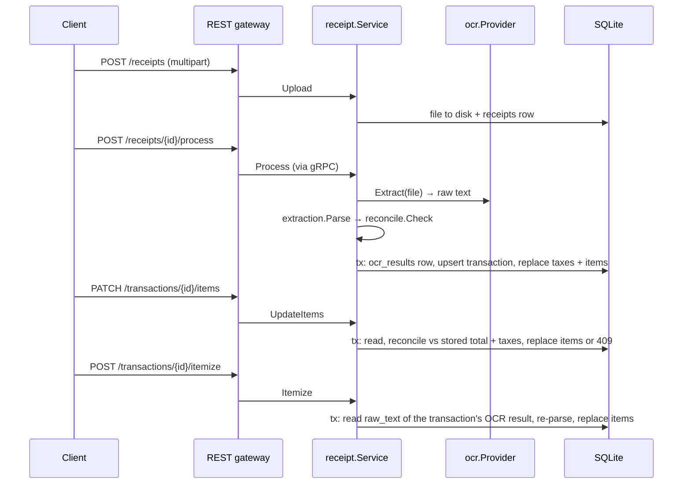

# Architecture

The service keeps two kinds of data separate:
- **Evidence:** what the paper said. This is the uploaded file and each OCR attempt, and it is never rewritten.
- **Interpretation:** the transaction, its taxes and its line items. This is derived from the evidence and can be edited by the user.

The logic that makes decisions lives in pure packages. A thin service connects those packages to the storage layer.

| Component | Responsibility | Depends on |
|---|---|---|
| `ocr.Provider` | Converts a file into raw text. The `stub` provider reads text uploads as-is and maps images and PDFs to fixture text by base name. | filesystem |
| `extraction.Parse` | Converts text into header, taxes and items. It skips summary lines, lines with no amount, and notes. Pure. | `money` |
| `reconcile.Check` | Checks that Σ items + Σ exclusive taxes equals the total (±1 cent) and returns the status, reason and gap. Pure. | none |
| `receipt.Service` | Orchestrates the flow and owns DB transactions and idempotency (one transaction per receipt). | repositories, the three above |
| repositories | Handle GORM on SQLite. Taxes and items are replaced by soft-deleting the old rows and inserting new ones. | `database` |

## Adding a real OCR vendor

1. Implement `ocr.Provider` for the vendor. For example, a vision model could return the receipt text, or a vendor such as Veryfi could return structured JSON rendered to text.
2. Add a case to `newOCRProvider` in `internal/boot/options.go`, and select it with `ocr.provider` / `APP_OCR_PROVIDER`.
3. Read the API key from an environment variable such as `APP_OCR_APIKEY`. Never put it in `config/*.toml`.

The provider name is recorded on every `ocr_results` row. Because each row stores its raw text, the parser can be improved and old receipts re-itemized without calling the vendor again.
